# Semantic Study Material Repository

DBMS Level 3 Project, PES University.
Team: Poorvi Rangaswamy (PES1UG24AM193), Rhea Menon (PES1UG24AM222)

Finding a specific concept across dozens of course notes with plain keyword search is hard. This web app lets faculty upload course notes, splits them into chunks, and lets students search them by meaning (semantic search) or by keyword. Every search is logged to MongoDB, and an aggregation report shows faculty which topics students could not find.

## Tech stack
- Frontend and API: Next.js (App Router, TypeScript, Tailwind)
- SQL: PostgreSQL on Neon, with the pgvector extension
- NoSQL: MongoDB Atlas
- Embeddings: all-MiniLM-L6-v2 via Transformers.js (runs locally, no API key)
- Auth: bcrypt password hashes, JWT in an httpOnly cookie, roles: admin, faculty, student

## Why each database
- PostgreSQL holds structured, relational data that needs integrity: users, courses, enrollments, documents, chunks, bookmarks.
- pgvector (inside PostgreSQL) stores chunk embeddings next to the chunk text, so one query can filter by course access and rank by similarity.
- MongoDB stores search logs: write-heavy, flexible events analysed with aggregation pipelines.

## Database design
- PostgreSQL (7 tables): users, courses, enrollments, documents, document_chunks, bookmarks, document_audit
- MongoDB: `search_logs` collection (user_id, role, course_id, query, mode, result_count, top_score, searched_at)
- ER diagram: see the ER Diagram section below (source for dbdiagram.io: `er-diagram.dbml`)
- Advanced features: transaction (`upload_document()`), triggers (chunk count sync, audit log), view (`course_material_summary`), full-text search (GIN index on tsvector), vector similarity search (HNSW index), MongoDB aggregation pipelines

## Vector search
| Question | Answer |
|---|---|
| What is embedded? | Every text chunk of every uploaded document, and each search query |
| Which model? | all-MiniLM-L6-v2 (384 dimensions), run with Transformers.js |
| How are vectors stored? | `document_chunks.embedding vector(384)` column (pgvector), with an HNSW index |
| Similarity metric? | Cosine similarity (pgvector `<=>` is cosine distance; similarity = 1 - distance) |
| How are results retrieved? | The query is embedded, then the top 10 nearest chunks are returned, limited to the user's accessible courses and above a minimum similarity (`MIN_SIMILARITY` in `webapp/app/api/search/route.ts`) |

The search page offers Semantic and Keyword modes. If semantic search fails, it falls back to keyword (full-text) search.

## Setup
1. Create a free PostgreSQL project on neon.tech and a free cluster on MongoDB Atlas (allow network access from 0.0.0.0/0).
2. In the Neon SQL Editor, run `database/schema.sql` (tables, triggers, view, functions, sample data).
3. Create `webapp/.env.local` using `.env.example` as a template.
4. Run:
   ```
   cd webapp
   npm install
   npm run dev
   ```
5. Open http://localhost:3000, log in as faculty, and click **Generate missing embeddings** on the dashboard. The first run downloads the model (about 25 MB). Semantic search works once chunks have embeddings; new uploads are embedded automatically.

Note: the app connects to Neon (port 5432) and Atlas (port 27017), which some college or public networks block. Use a phone hotspot if connections time out.

## Demo accounts (password: password123)
- admin@pes.edu (admin)
- rao@pes.edu (faculty)
- poorvi@pes.edu (student)

## Project structure
- `database/schema.sql`: DDL, constraints, indexes, view, triggers, functions, sample data
- `database/reports.sql`: report queries and advanced-feature demos
- `webapp/app/api`: backend route handlers (auth, courses, documents, search, reports, embed)
- `webapp/lib`: database, MongoDB, auth, chunking and embedding helpers
- `er-diagram.*`: ER diagram image and its dbdiagram.io source
- `screenshots/`: screenshots used in this README

## ER Diagram
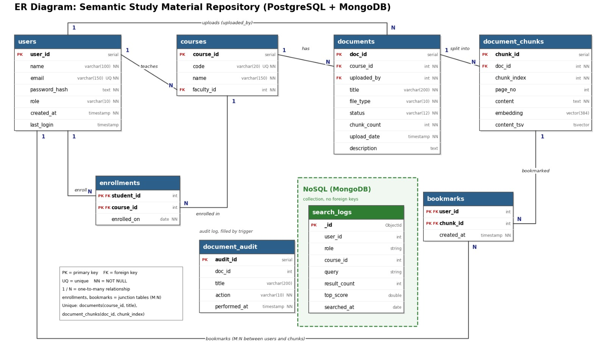

7 PostgreSQL tables (`enrollments` and `bookmarks` are junction tables for the two many-to-many relationships) plus the MongoDB `search_logs` collection, shown separately because it has no foreign keys.

## Screenshots

### Application
**Login page**
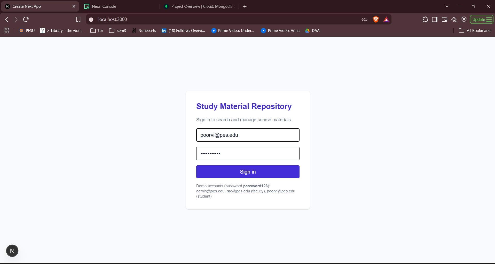

**Student dashboard: only enrolled courses are visible**
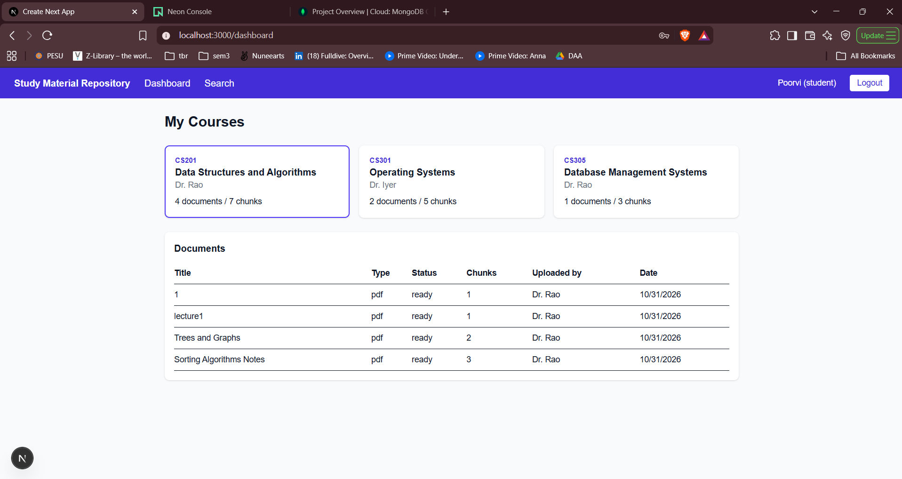

**Faculty dashboard: upload form and delete actions**
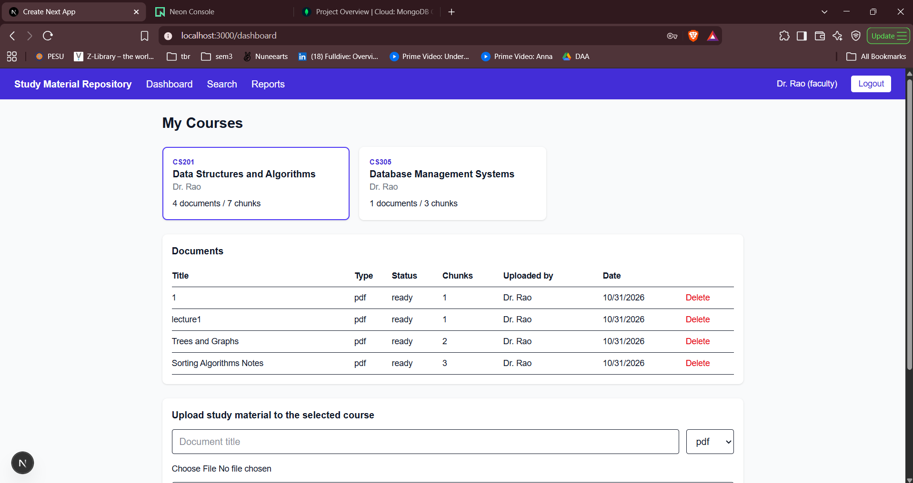

**Keyword search (PostgreSQL full-text) with highlighted matches**
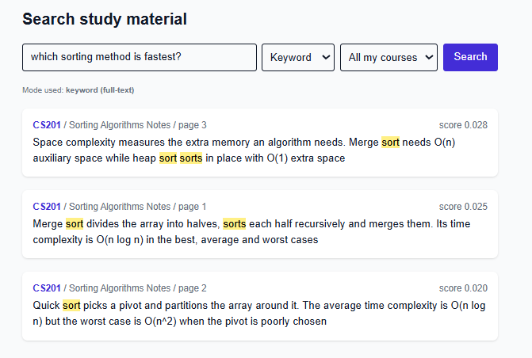

**Semantic search (pgvector cosine similarity) for the same question**
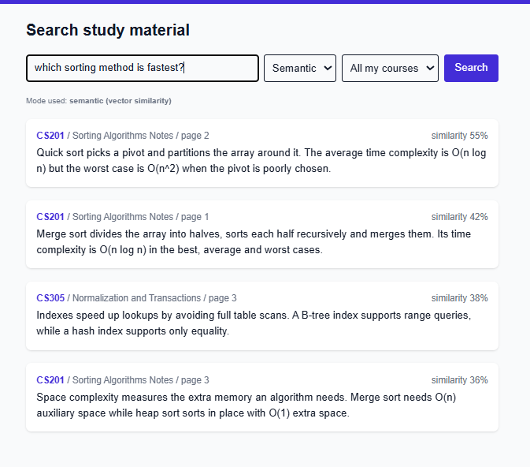

**A search with no results is logged to MongoDB**
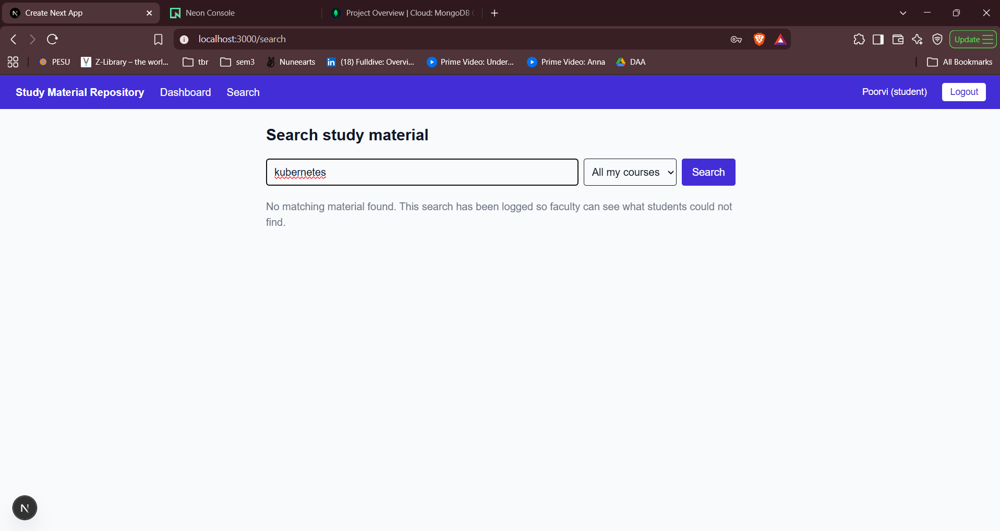

**Reports: SQL queries (view, JOIN, GROUP BY, HAVING, subquery)**
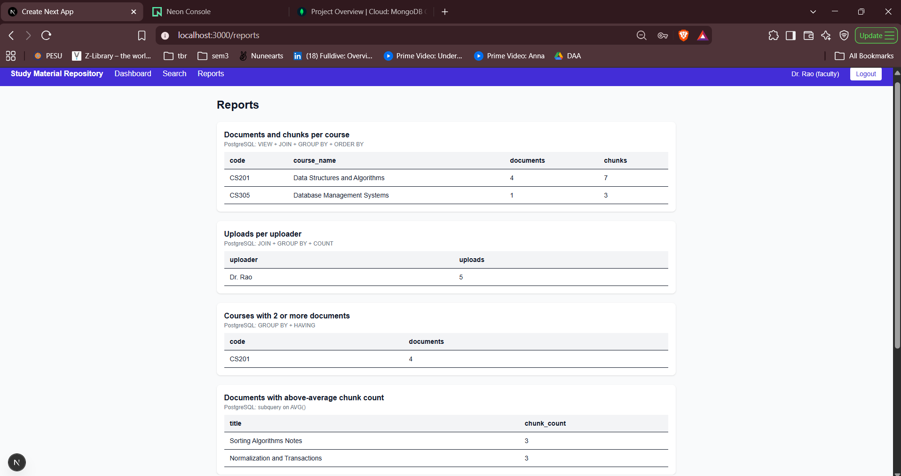

**Reports: MongoDB aggregations, including "Topics students could not find"**
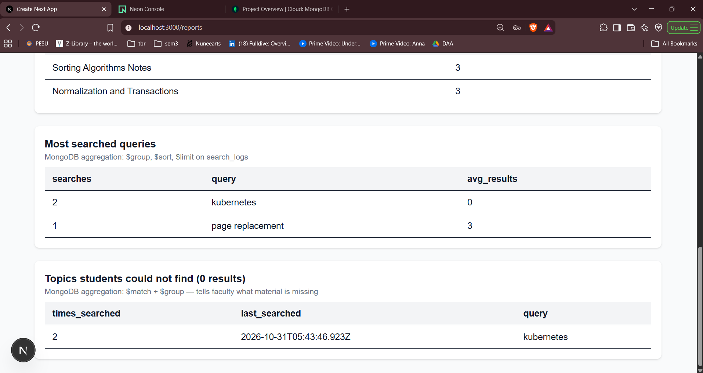

### Database
**Neon: the 7 tables and the `course_material_summary` view**
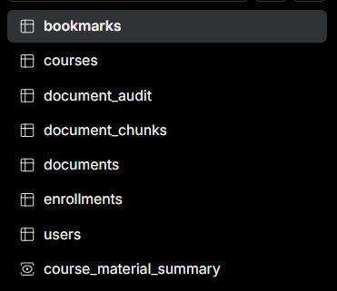

**Row counts after loading the sample data**
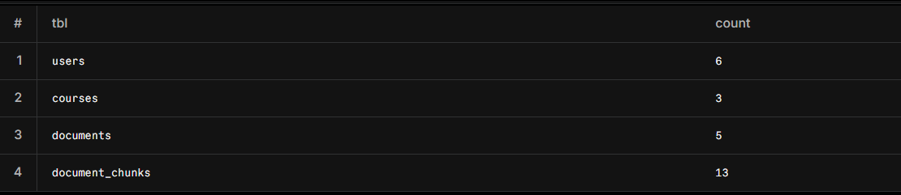

**MongoDB Atlas: the `search_logs` collection**
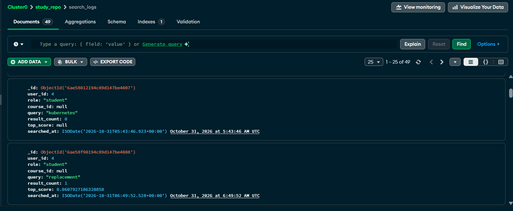

### Integrity and validation
**Duplicate title rejected, shown in the app**
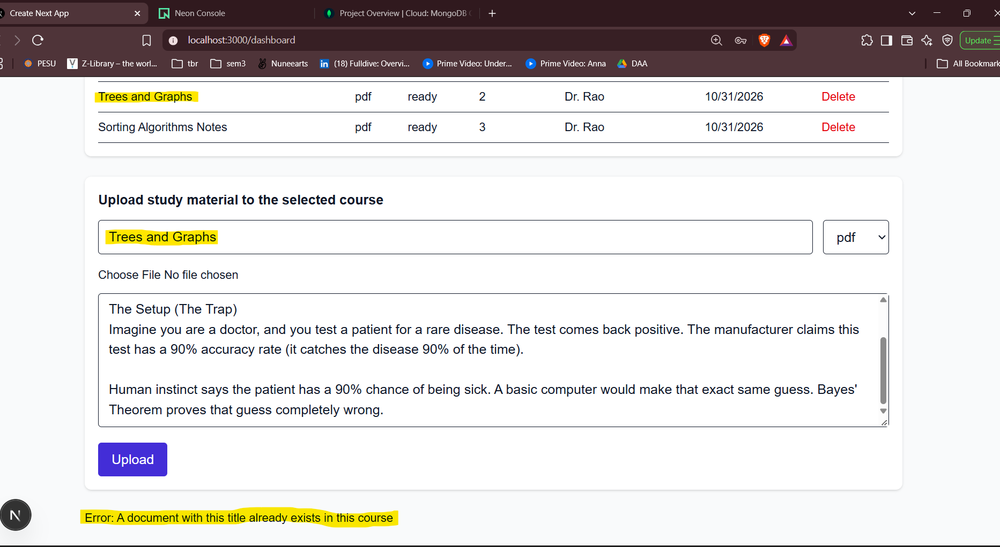

**Duplicate title rejected by the UNIQUE constraint in SQL**
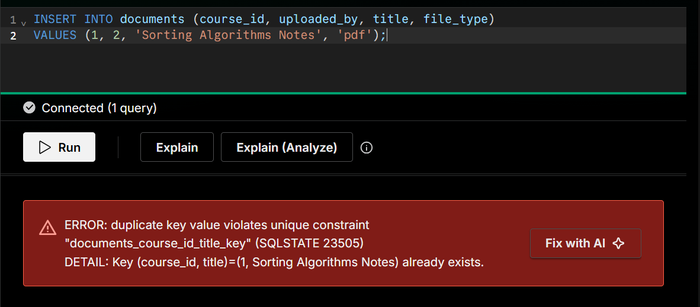

**Invalid email rejected by a CHECK constraint**
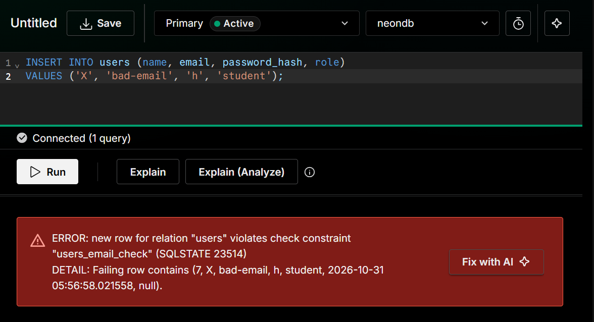

### Advanced database features
**Trigger: `chunk_count` is maintained automatically**
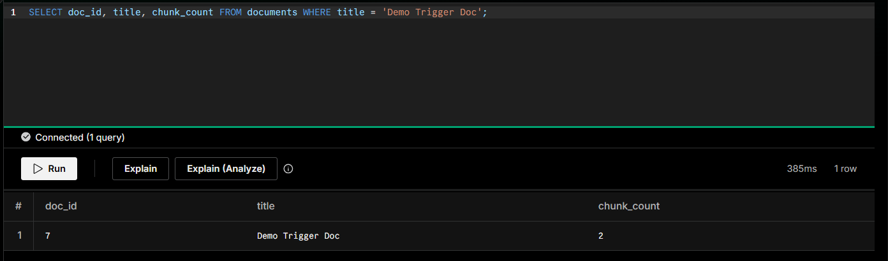

**Trigger: INSERT and DELETE are written to `document_audit`**
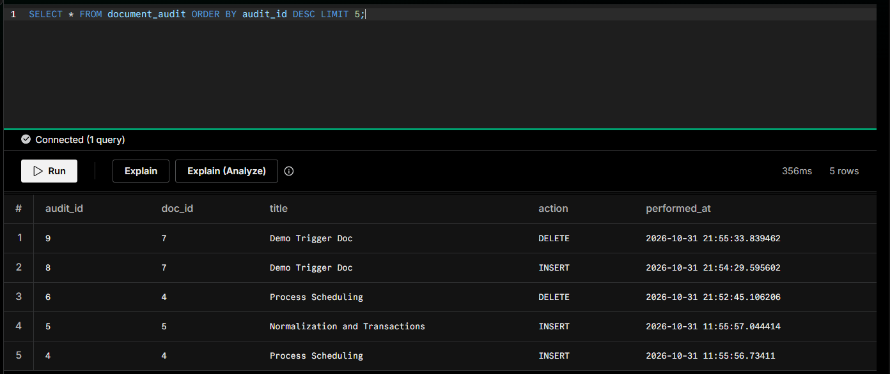

**Transaction: a failed upload raises an error...**
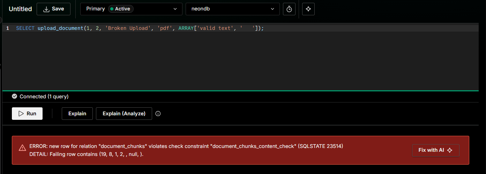

**...and leaves nothing behind (document and valid chunk rolled back)**
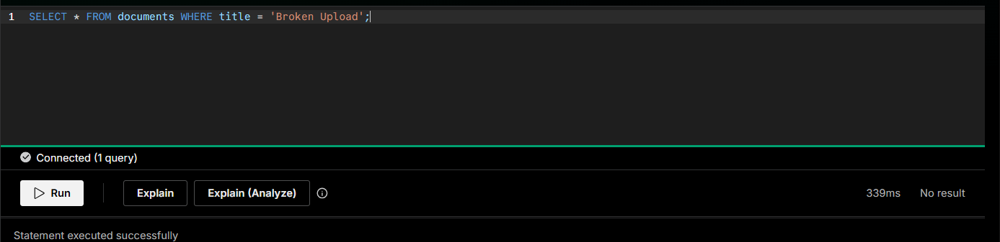

**View: `course_material_summary`**
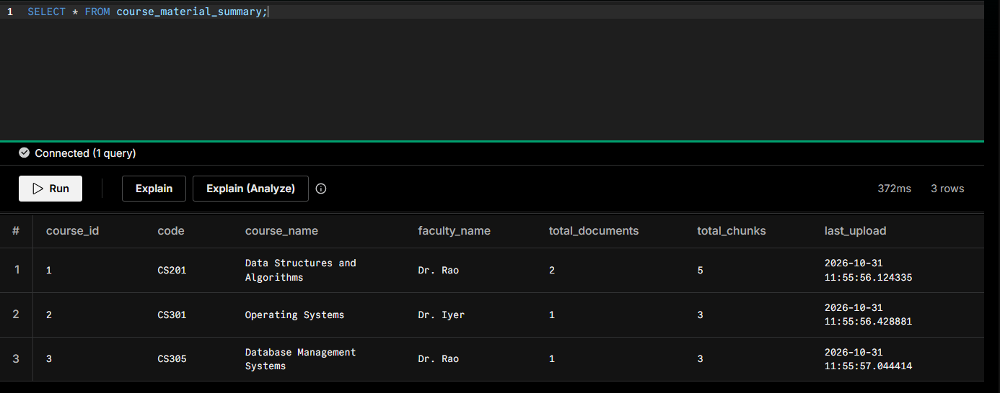

### Vector search
**Embeddings are 384-dimensional vectors stored in pgvector**
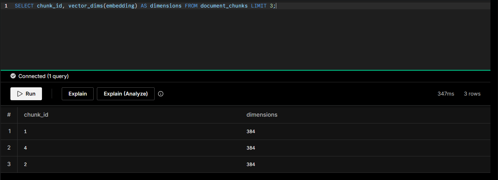

**Nearest chunks to chunk 1 by cosine similarity (plain SQL)**
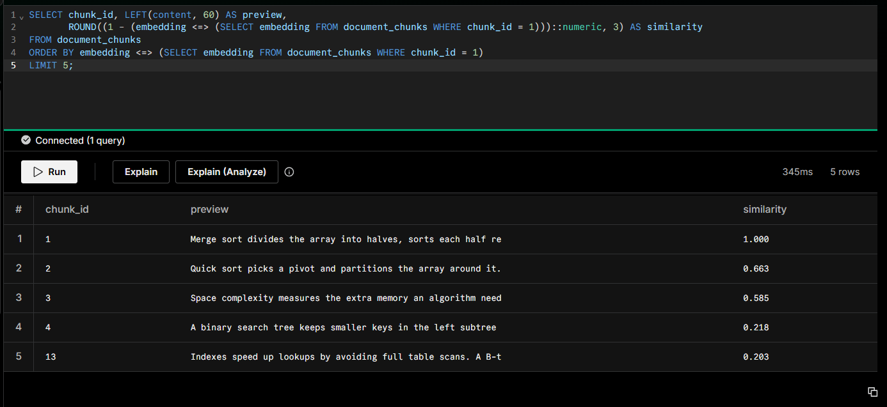

### Team
**Commit history showing both team members' contributions**
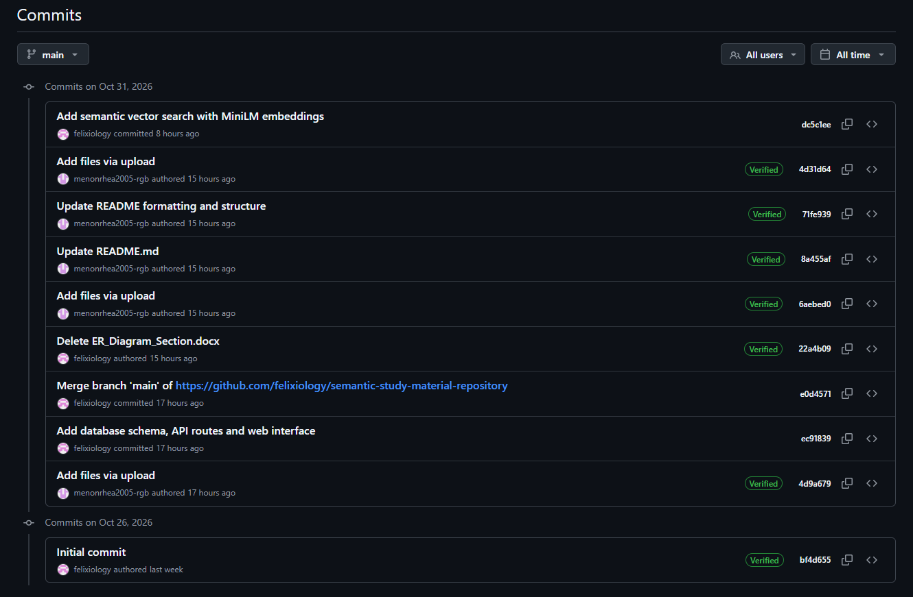

## Known limitations and future work
- Uploads accept pasted text or .txt files; PDF text extraction is planned.
- Bookmarks exist in the schema but have no screen yet.
- Courses and enrollments are managed through SQL; an admin screen is planned.

